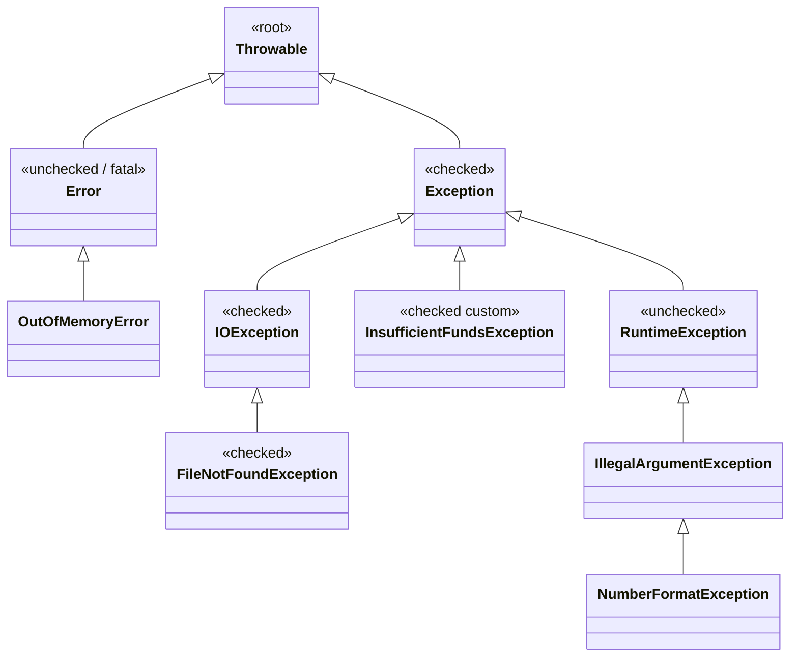

# Q1 – Handling Failure in a Bank ATM Simulation

**Bloom's Level: K4 – Analyse | Marks: 6**  
**CO3 Coverage**: Exception hierarchy, checked/unchecked exceptions, try-catch-finally, multi-catch, catch block ordering.

---

## 1. Shared Group Work: Failure Points & Classification

| Failure Point | Root Cause Scenario | Exception / Error Classification | Java Type |
| :--- | :--- | :--- | :--- |
| **Card Reader Missing** | Sensor device driver file missing or unreadable | **Checked Exception** | `java.io.FileNotFoundException` (extends `IOException`) |
| **Non-Numeric Input** | User enters letters (e.g. `"FIVE_HUNDRED"`) | **Unchecked Exception** | `java.lang.NumberFormatException` (extends `IllegalArgumentException`) |
| **Negative Amount** | User enters `<= 0` amount | **Unchecked Exception** | `java.lang.IllegalArgumentException` (extends `RuntimeException`) |
| **Overdraft Request** | Withdrawal amount exceeds balance | **Checked Exception (Domain)**| `InsufficientFundsException` (extends `Exception`) |
| **JVM Memory Depletion**| Hardware out-of-memory during transaction | **Error (Fatal)** | `java.lang.OutOfMemoryError` (extends `VirtualMachineError`) |

---

## 2. Student A – Exception Design

### A. Relevant Throwable Hierarchy Diagram



### B. Exception Catch Table & Ordering Justification
- **Ordering Rule**: In Java, **subclass catch blocks must strictly precede superclass catch blocks**.
- `FileNotFoundException` is caught before `IOException`, which is caught before generic `Exception`.
- `NumberFormatException` and `IllegalArgumentException` are combined using **multi-catch** (`catch (NumberFormatException | IllegalArgumentException e)`).
- If a superclass catch (e.g., `catch (Exception e)`) were placed first, all subsequent catch blocks would trigger a **compile-time error: `error: exception has already been caught (unreachable code)`**.

### C. What the `finally` Block Guarantees
- The `finally` block executes **unconditionally**, regardless of whether the `try` block completes normally, throws an exception caught by a handler, or encounters an unexpected runtime error.
- **ATM Guarantee**: Guarantees that the physical user debit card is ejected, hardware reader latch unlocked, and transaction session invalidated so the next customer cannot access the previous user's account.

---

## 3. Student B – Testing and Tracing

### A. Test Execution Matrix (5 Distinct Failure Paths)

| Test # | Account Input | Amount Input | Card Reader Status | Catch Block Triggered | Finally Executed? | Result |
| :---: | :--- | :--- | :--- | :--- | :---: | :--- |
| **1** | `"100234"` | `"1500.00"` | Connected | None (Success path) | **YES** | Cash dispensed (Rs 1500.00) |
| **2** | `"100234"` | `"FIFTEEN"` | Connected | `NumberFormatException` | **YES** | Input error reported |
| **3** | `"100234"` | `"-500.00"` | Connected | `IllegalArgumentException` | **YES** | Rejection: Amount $\le 0$ |
| **4** | `"100234"` | `"10000.00"`| Connected | `InsufficientFundsException` | **YES** | Rejection: Insufficient funds |
| **5** | `"100234"` | `"500.00"` | Disconnected | `FileNotFoundException` | **YES** | Hardware fault reported |

### B. Stack Trace Analysis for Uncaught Exception
```text
Exception in thread "main" java.lang.NumberFormatException: For input string: "FIFTEEN"
    at java.base/java.lang.NumberFormatException.forInputString(NumberFormatException.java:67)
    at java.base/java.lang.Integer.parseInt(Integer.java:668)
    at ATMSimulation.withdraw(ATMSimulation.java:54)
    at ATMSimulation.main(ATMSimulation.java:125)
```
- **Line 1**: Declares the thread (`"main"`) and exception type (`NumberFormatException`) with root error description (`"FIFTEEN"`).
- **Line 2**: Internal JDK factory method throwing the exception.
- **Line 3**: `Integer.parseInt()` attempting string-to-primitive conversion.
- **Line 4**: Caller frame in `ATMSimulation.withdraw()` where `parseInt()` was invoked.
- **Line 5**: Entry point invocation in `main()`.

---

## 4. Joint Design Question

### Question: Should the ATM program catch every exception with a single `catch (Exception e)`?
**Answer**:
- **When Acceptable**: Acceptable **only** as a final top-level safety-net logger (e.g. at the outer thread boundary or main loop) to prevent the entire ATM OS process from abruptly terminating.
- **What is Lost**:
  1. **Loss of Granular Recovery**: The system cannot distinguish between a transient client error (typing letters, requiring re-prompt) and a critical hardware failure (card reader disconnected, requiring ATM out-of-service lockout).
  2. **Audit & Compliance Impairment**: Banking regulations mandate explicit logging of fraud attempts vs hardware failures vs overdrafts.
  3. **Silent Masking of Programmer Bugs**: A blanket catch swallows `NullPointerException` or indexing bugs that should be discovered during testing.

---

## 5. Alternative Concept & Complexity Analysis

### Exceptions vs. Return Error Codes (e.g. `Scanner.hasNextInt()`, return `-1`)

| Metric | Exception Handling (`try-catch`) | Return Error Codes (`return -1, -2, -3`) |
| :--- | :--- | :--- |
| **Code Readability & Separation** | **High**: Happy path completely separated from error recovery routines. | **Poor**: Every method call surrounded by `if (ret < 0)` cascades. |
| **Ignoring Errors** | **Impossible to ignore**: Unhandled exceptions abort control flow safely. | **High Risk**: Caller can easily forget to check return code, propagating invalid state. |
| **Time Cost (Normal Path)** | **Zero overhead** (Modern JVM zero-cost exception handling using table lookups). | Small continuous branch checking overhead ($O(1)$ CPU compare). |
| **Time Cost (Error Path)** | **Higher**: JVM captures stack trace ($O(D)$ where $D$ is call stack depth). | **Negligible**: Simply returns an integer register ($O(1)$). |
| **Space Cost** | Allocates `Throwable` instance + array of `StackTraceElement` objects (~1 KB per throw). | $O(1)$ zero memory allocation (uses CPU register). |

---

## 6. Compilation and Execution

```bash
# Compile
javac "ASSESMENT 3/Q1/src/ATMSimulation.java" -d "ASSESMENT 3/Q1/bin"

# Run
java -cp "ASSESMENT 3/Q1/bin" ATMSimulation
```
