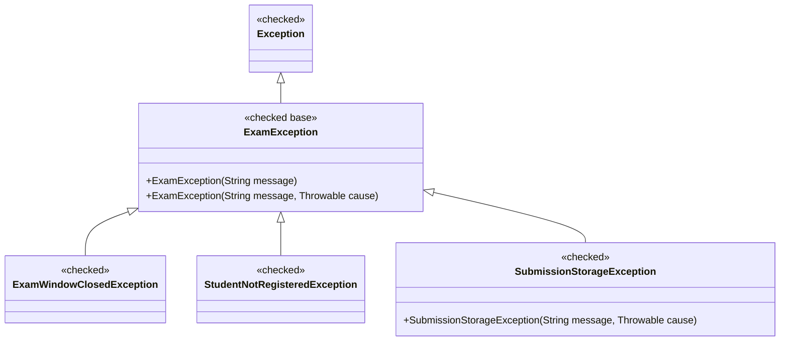

# Q2 – User-Defined Exceptions and Propagation in an Online Examination Portal

**Bloom's Level: K4 – Analyse | Marks: 7**  
**CO3 Coverage**: User-defined custom exceptions, checked vs unchecked exceptions, 3-tier propagation, exception chaining (`getCause()`), throw/throws.

---

## 1. Shared Group Work: Exception Hierarchy & Tiered Rules



### Rationale: Checked vs. Unchecked Selection
- All portal exceptions extend `ExamException` (checked), because these conditions represent **recoverable domain failure states**:
  - A closed window requires redirecting the student to an appeal form.
  - An unregistered student requires routing to course enrollment.
  - A storage quota failure allows retrying with a compressed PDF.
- Using checked exceptions forces every layer in the 3-tier pipeline (`Controller`, `Service`, `Storage`) to explicitly handle or declare (`throws`) failures.

---

## 2. Student A – Hierarchy & Propagation Architecture

### 3-Layer Propagation Trace for `SubmissionStorageException`

```
[Layer 3: StorageLayer]
  Low-level IOException("Disk quota exceeded") occurs on disk write.
  StorageLayer catches IOException and wraps it:
  throw new SubmissionStorageException("Could not store answer02.pdf", e);
            │
            ▼  (Propagates via 'throws ExamException')
[Layer 2: ServiceLayer]
  service.processSubmission(...) receives exception; does not catch; propagates upward.
            │
            ▼  (Propagates via 'throws ExamException')
[Layer 1: Controller / UI Layer]
  Controller catches SubmissionStorageException:
  - Logs root cause: e.getCause().getMessage() -> "Disk quota exceeded"
  - Renders user-friendly message to student: "Error: Could not store answer02.pdf"
```

---

## 3. Student B – Failure Scenarios & Exception Chaining Evidence

### A. Test Scenario Table

| Scenario | Input Condition | Exception Thrown | Handled In | Student UI Message |
| :--- | :--- | :--- | :--- | :--- |
| **Normal Submission** | Enrolled student, 250 KB file, 11:00 AM | None | Controller | `Submission successful! Confirmation receipt issued.` |
| **Unregistered Student**| Invalid ID `"REG_INVALID"` | `StudentNotRegisteredException` | Controller | `Student ID REG_INVALID is not enrolled in course CSA0909.` |
| **Late Submission** | Submit attempt at 14:00 (Window closed 13:00) | `ExamWindowClosedException` | Controller | `Submission portal closed at 13:00. Attempted at 14:00.` |
| **Quota Overflow** | 800 KB file (Quota 500 KB) | `SubmissionStorageException` | Controller | `Error: Could not store answer02.pdf` (Cause: Disk quota exceeded) |

### B. Chained Stack Trace Representation
```text
SubmissionStorageException: Could not store answer02.pdf
    at Storage.save(StorageDemo.java:23)
    at StorageDemo.main(StorageDemo.java:31)
Caused by: java.io.IOException: Disk quota exceeded
    at Storage.save(StorageDemo.java:18)
    ... 1 more
```

### C. What is Lost If Re-thrown Without Cause?
If re-thrown as `throw new SubmissionStorageException(message)` without passing `cause`:
1. The `getCause()` method returns `null`.
2. The low-level disk/OS diagnostic error (`"Disk quota exceeded"`, `"Permission denied"`, or `"Bad sector"`) is completely wiped out.
3. System administrators cannot determine whether the storage failed due to disk fullness, network SAN detachment, or file permission locks.

---

## 4. Joint Conclusion

### Why throw `SubmissionStorageException` instead of raw `IOException`?
1. **Architectural Decoupling**: Leaking `java.io.IOException` directly into presentation/controller controllers violates separation of concerns. If the underlying storage engine changes from local disk files to an Amazon S3 cloud bucket or MongoDB GridFS, the controller code would be forced to catch AWS or Mongo exceptions.
2. **Security & Abstraction**: Exposing raw OS paths, file descriptors, or disk partition details to the student interface exposes internal infrastructure topology and potential security vulnerabilities.
3. **Domain Semantics**: High-level layers only care that *submission storage failed*, not which low-level POSIX inode error occurred.

---

## 5. Complete the Code & Verification

### Completed `StorageDemo.java`
```java
class Storage {
    void save(String fileName, long sizeKb) throws SubmissionStorageException {
        try {
            if (sizeKb > 500) throw new IOException("Disk quota exceeded");
            System.out.println("Saved " + fileName);
        } catch (IOException e) {
            // TODO 1: Wrap the IOException in a SubmissionStorageException, keeping the
            // IOException as its cause
            throw new SubmissionStorageException("Could not store " + fileName, e);
        }
    }
}
```

### Execution Output (Exact Match with Prompt)
```
Saved answer01.pdf
Error: Could not store answer02.pdf
Cause: Disk quota exceeded
```

### Follow-up Question Answer:
> *Explain what would be printed in the Cause line if the `IOException` were not passed to the constructor.*

If `e` is omitted, the default `cause` in `Throwable` remains `null`. When executing:
```java
System.out.println("Cause: " + e.getCause().getMessage());
```
`e.getCause()` returns `null`, causing an unhandled **`java.lang.NullPointerException`** when calling `.getMessage()`, crashing the program.

---

## 6. Alternative Concept & Complexity Analysis

### Checked vs. Unchecked Custom Exceptions (`extends RuntimeException`)

| Criterion | Checked Custom Exceptions (`extends Exception`) | Unchecked Custom Exceptions (`extends RuntimeException`) |
| :--- | :--- | :--- |
| **Method Signatures** | Every intermediate layer must declare `throws ExamException` in method headers. | Clean signatures; no `throws` clauses required. |
| **Compiler Enforcement** | Compiler enforces that caller must catch or declare; zero forgotten failure cases. | Caller can ignore error handling; unhandled exceptions propagate to thread crash. |
| **Time Cost per Throw** | Both invoke JVM `fillInStackTrace()` costing $O(D)$ proportional to stack depth $D$ (~1 to 5 µs). | Identical $O(D)$ stack capture time. |
| **Space Cost with Chaining** | Holds outer exception object + reference to inner `Throwable` cause + 2 stack trace arrays (~1.5 KB to 3 KB heap). | Identical memory footprint. |

---

## 7. Compilation and Execution

```bash
# Compile
javac "ASSESMENT 3/Q2/src/StorageDemo.java" -d "ASSESMENT 3/Q2/bin"
javac "ASSESMENT 3/Q2/src/ExamPortalArchitectureDemo.java" -d "ASSESMENT 3/Q2/bin"

# Run StorageDemo
java -cp "ASSESMENT 3/Q2/bin" StorageDemo

# Run Architecture Demo
java -cp "ASSESMENT 3/Q2/bin" ExamPortalArchitectureDemo
```
