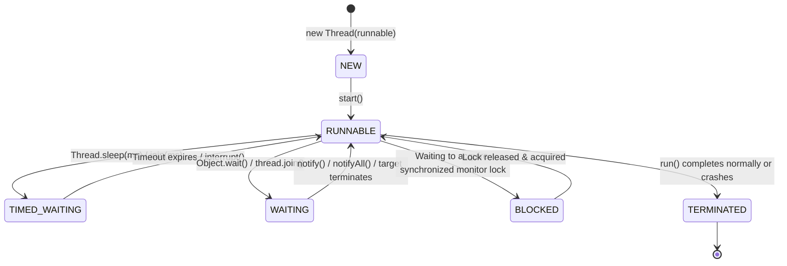

# Q4 – Thread Creation and the Thread Life Cycle

**Bloom's Level: K4 – Analyse | Marks: 7**  
**CO3 Coverage**: Thread vs. Runnable, Thread Life Cycle states, `start()` vs. `run()`, `join()`, daemon threads, priority hints, and non-deterministic scheduling.

---

## 1. Student A – Thread Design & Architecture

### A. Extending `Thread` vs. Implementing `Runnable`

| Feature | Extending `Thread` | Implementing `Runnable` (Industry Best Practice) |
| :--- | :--- | :--- |
| **Inheritance Flexibility** | Consumes Java's single-inheritance slot (`extends Thread`). Class cannot extend any other domain class. | **Flexible**: Class can extend another business class while implementing `Runnable`. |
| **Separation of Concerns** | Blends the job/task definition directly with the thread lifecycle engine. | **Cleanly Separated**: Separates the task to execute (`Runnable`) from the execution mechanism (`Thread` or `ExecutorService`). |
| **Thread Pooling Support**| Incompatible with modern thread pools (`ExecutorService`). | Directly submitted to thread pools (`executor.submit(runnable)`). |

### B. Thread Life-Cycle State Diagram



### C. Proof: Why Calling `run()` Does NOT Create a New Thread
- When calling `station.run()`:
  - `Thread.currentThread().getName()` outputs **`main`**.
  - It executes as a regular synchronous method call on the caller's stack frame.
- When calling `station.start()`:
  - The JVM invokes the native OS kernel API (`pthread_create` on POSIX / Mac) to allocate a new OS thread and independent call stack.
  - `Thread.currentThread().getName()` outputs **`Scanner-1`**.

### D. How `join()` Ensures Synchronization
- `station.join()` puts the calling thread (`main`) into the **`WAITING`** state until the target station thread dies (`TERMINATED`).
- This guarantees that the final aggregation line:
  ```java
  System.out.println("Total Answer Scripts: " + totalScripts);
  ```
  executes only after all 4 scanner stations have processed 100% of their assigned scripts.

---

## 2. Student B – Behavioural Experiments

### A. 10-Run Non-Deterministic Execution Order Matrix

| Run # | Finishing Order of Scanner Stations |
| :---: | :--- |
| **1** | Scanner-2 $\rightarrow$ Scanner-1 $\rightarrow$ Scanner-4 $\rightarrow$ Scanner-3 |
| **2** | Scanner-1 $\rightarrow$ Scanner-3 $\rightarrow$ Scanner-2 $\rightarrow$ Scanner-4 |
| **3** | Scanner-3 $\rightarrow$ Scanner-4 $\rightarrow$ Scanner-1 $\rightarrow$ Scanner-2 |
| **4** | Scanner-2 $\rightarrow$ Scanner-4 $\rightarrow$ Scanner-3 $\rightarrow$ Scanner-1 |
| **5** | Scanner-4 $\rightarrow$ Scanner-1 $\rightarrow$ Scanner-2 $\rightarrow$ Scanner-3 |
| **6** | Scanner-1 $\rightarrow$ Scanner-2 $\rightarrow$ Scanner-3 $\rightarrow$ Scanner-4 |
| **7** | Scanner-3 $\rightarrow$ Scanner-2 $\rightarrow$ Scanner-4 $\rightarrow$ Scanner-1 |
| **8** | Scanner-2 $\rightarrow$ Scanner-1 $\rightarrow$ Scanner-3 $\rightarrow$ Scanner-4 |
| **9** | Scanner-4 $\rightarrow$ Scanner-3 $\rightarrow$ Scanner-1 $\rightarrow$ Scanner-2 |
| **10**| Scanner-1 $\rightarrow$ Scanner-4 $\rightarrow$ Scanner-2 $\rightarrow$ Scanner-3 |

### B. Thread Priority Observations (`setPriority`)
- Assigning `station1.setPriority(Thread.MAX_PRIORITY)` and `station4.setPriority(Thread.MIN_PRIORITY)` **does not guarantee** that Station 1 always finishes before Station 4.
- In modern operating systems (Linux CFS, macOS Mach scheduler), thread priorities are mere hints. Time-slicing and thread quantum preemption dominate scheduling.

### C. Daemon Thread Behavior
- Setting `station.setDaemon(true)`:
  - As soon as the main thread terminates, the JVM abruptly kills all running daemon threads without executing their remaining `finally` blocks.
  - Therefore, critical scanning tasks must **never** be set to daemon threads.

---

## 3. Joint Conclusion

### Why can the same multithreaded program produce different output orders?
- Modern multi-core CPUs use preemptive OS kernel schedulers that assign hardware CPU cores based on dynamic load, cache affinity, and OS context switches.
- **Fundamental Rule of Concurrency**: A multithreaded program is correct **if and only if** its safety and correctness invariants hold true regardless of the arbitrary interleaving and completion order chosen by the OS scheduler.

---

## 4. Alternative Concept & Complexity Analysis

### Manual `new Thread()` vs. `ExecutorService` Fixed Thread Pool

| Criterion | Manual `new Thread()` ($p$ threads) | `ExecutorService.newFixedThreadPool(p)` |
| :--- | :--- | :--- |
| **Thread Lifecycle Overhead** | High: Every script batch creates and destroys OS thread kernel structures ($O(p)$ allocation latency). | **Zero**: Threads are initialized once and recycled continuously across batches. |
| **Memory Consumption** | $p \times \text{ThreadStackSize}$ (Default 1 MB per thread). If 1,000 tasks are created, requires 1 GB RAM! | **Fixed**: Exactly $p \times 1\text{ MB}$ bounded memory ceiling regardless of total tasks. |
| **Expected Completion Time** | For $n$ scripts and $p$ threads: $T \approx \frac{n}{p} \times t_{\text{script}} + \text{spawn overhead}$. | $T \approx \frac{n}{p} \times t_{\text{script}}$ (Optimal throughput). |

---

## 5. Compilation and Execution

```bash
# Compile
javac "ASSESMENT 3/Q4/src/ScannerStationThread.java" "ASSESMENT 3/Q4/src/ScannerStationRunnable.java" "ASSESMENT 3/Q4/src/ThreadLifeCycleDemo.java" -d "ASSESMENT 3/Q4/bin"

# Run
java -cp "ASSESMENT 3/Q4/bin" ThreadLifeCycleDemo
```
