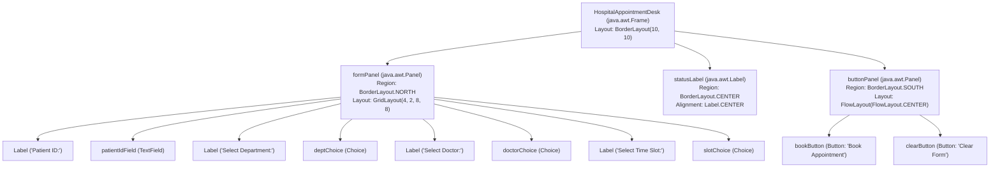

# Task 2: From Requirement to Event-Driven Design - Hospital Outpatient Appointment Desk

**Course**: Programming in Java (CO4 - Event-Driven GUI Design)  
**Student Name**: Thejas Balaji  
**Register Number**: 192565092  
**Marks**: 8 Marks | **Bloom's Level**: K4 (Analyse)  

---

## 2.1 Event-Handling Model

The table below models all event sources, generated event objects, required listener interfaces, and corresponding handler actions for the Outpatient Appointment Desk:

| # | Event Source (GUI Component) | Event Object Generated | Listener Interface Needed | Trigger / Interaction | Action Taken by Handler |
|---|-----------------------------|------------------------|---------------------------|-----------------------|-------------------------|
| **1** | `deptChoice` (`java.awt.Choice`) | `java.awt.event.ItemEvent` | `java.awt.event.ItemListener` (`itemStateChanged`) | User clicks or selects a different medical department from the dropdown. | Extracts selected department string, clears all existing items in `doctorChoice`, fetches and populates corresponding doctors for that department, and updates `statusLabel`. |
| **2** | `bookButton` (`java.awt.Button`) | `java.awt.event.ActionEvent` | `java.awt.event.ActionListener` (`actionPerformed`) | User clicks the "Book Appointment" button or presses Enter while focused. | Reads and trims `patientIdField`. Validates non-emptiness and format. Validates selected doctor and time slot. If valid, generates confirmation, updates status label in green, and clears in-progress flag; otherwise displays validation error in red. |
| **3** | `clearButton` (`java.awt.Button`) | `java.awt.event.ActionEvent` | `java.awt.event.ActionListener` (`actionPerformed`) | User clicks the "Clear Form" button. | Clears text fields, resets department and slot dropdowns to default index 0, repopulates initial doctor list, and resets status message. |
| **4** | `patientIdField` (`java.awt.TextField`) | `java.awt.event.TextEvent` / `KeyEvent` | `java.awt.event.TextListener` / `KeyListener` | User types or edits characters in the Patient ID field. | Sets internal `isBookingInProgress = true` flag to track unsaved form entry. |
| **5** | Outer Window (`java.awt.Frame`) | `java.awt.event.WindowEvent` | `java.awt.event.WindowListener` (`windowClosing`) via `WindowAdapter` | User clicks the operating system window close button (`[X]`). | Checks if `isBookingInProgress == true` and Patient ID has input. If active, displays confirmation warning or dialog to prevent accidental data loss. If user confirms or no active booking, disposes the frame and cleans up resources. |

---

## 2.2 Component Hierarchy (Containment Tree)

The visual containment tree below specifies the nesting structure using standard AWT/Swing container and component classes:



---

## 2.3 Handler Logic (SIMATS Pseudocode)

### (a) Dynamic Doctor List Update on Department Change
```text
ALGORITHM RefreshDoctorDropdownOnDepartmentChange(event)
BEGIN
    IF event.getStateChange() == ItemEvent.SELECTED THEN
        selectedDepartment <- deptChoice.getSelectedItem()
        
        doctorChoice.removeAll() // Clear previous options
        
        doctorList <- LookupDoctorsByDepartment(selectedDepartment)
        
        FOR EACH doctor IN doctorList DO
            doctorChoice.add(doctor)
        END FOR
        
        doctorChoice.select(0) // Select first doctor by default
        statusLabel.setText("Department changed to " + selectedDepartment + ". Doctors refreshed.")
        isBookingInProgress <- TRUE
    END IF
END
```

### (b) Input Validation and Appointment Booking
```text
ALGORITHM ValidateAndBookAppointment()
BEGIN
    patientId <- TRIM(patientIdField.getText())
    
    // 1. Validation Checks
    IF patientId IS EMPTY THEN
        statusLabel.setForeground(COLOR_RED)
        statusLabel.setText("Validation Error: Patient ID cannot be blank.")
        patientIdField.requestFocus()
        RETURN FALSE
    END IF
    
    IF doctorChoice.getItemCount() == 0 THEN
        statusLabel.setForeground(COLOR_RED)
        statusLabel.setText("Validation Error: No doctors available for selected department.")
        RETURN FALSE
    END IF
    
    // 2. Extract Selected Values
    chosenDept   <- deptChoice.getSelectedItem()
    chosenDoctor <- doctorChoice.getSelectedItem()
    chosenSlot   <- slotChoice.getSelectedItem()
    
    // 3. Confirm Booking
    statusLabel.setForeground(COLOR_GREEN)
    statusLabel.setText("SUCCESS: Appt confirmed for " + patientId + " with " + chosenDoctor + " (" + chosenDept + ") at " + chosenSlot)
    
    isBookingInProgress <- FALSE // Reset dirty flag
    RETURN TRUE
END
```

---

## 2.4 Event Sequence Trace vs Applet Lifecycle

### Runtime Event Sequence (Desk Opening to Closing)
```
1. Frame Instantiation & setVisible(true)
   └─► ComponentEvent (COMPONENT_SHOWN)
   └─► WindowEvent (WINDOW_OPENED)
   └─► PaintEvent (Initial paint of Frame, Panels, Choices, and Buttons)

2. User types "PAT-98421" in patientIdField
   └─► KeyEvent (KEY_TYPED) & TextEvent (TEXT_VALUE_CHANGED) -> marks isBookingInProgress = TRUE

3. User changes Department from "Cardiology" to "Neurology"
   └─► ItemEvent (ITEM_STATE_CHANGED) -> refreshDoctorList() repopulates doctor dropdown
   └─► PaintEvent (Repaint of doctorChoice)

4. User clicks "Book Appointment" button
   └─► MouseEvent (MOUSE_PRESSED -> MOUSE_RELEASED -> MOUSE_CLICKED)
   └─► ActionEvent (ACTION_PERFORMED) -> processBooking() validates inputs & updates statusLabel
   └─► PaintEvent (Repaint of statusLabel with confirmation text in Green)

5. User clicks Window Close Button [X]
   └─► WindowEvent (WINDOW_CLOSING) -> handleWindowClosing() checks isBookingInProgress
   └─► WindowEvent (WINDOW_CLOSED) -> Frame.dispose() releases native display resources
```

### Comparison with Applet Lifecycle

| Phase / Aspect | AWT/Swing Application Lifecycle | Java Applet Lifecycle (`java.applet.Applet`) |
|----------------|---------------------------------|----------------------------------------------|
| **Initialization** | Constructor -> `setupUI()` -> `registerEventHandlers()` | `init()` method invoked by browser/appletviewer once upon loading bytecode. |
| **Activation / Display** | `frame.setVisible(true)` -> `WINDOW_OPENED` | `start()` method called every time the page becomes active or visited. |
| **Rendering** | `paint(Graphics g)` / `paintComponent(Graphics g)` on EDT triggered by OS or `repaint()` | `paint(Graphics g)` called automatically after `start()` or when browser refreshes viewport. |
| **Deactivation** | Window iconified (`WINDOW_ICONIFIED`) or loses focus (`WINDOW_DEACTIVATED`) | `stop()` called whenever user navigates away from the web page or tabs out. |
| **Destruction / Cleanup** | `windowClosing()` -> `dispose()` releases native peer resources | `destroy()` called once when applet is unloaded from browser cache/JVM. |
| **Execution Context** | Standalone OS desktop window with entry point `public static void main(String[] args)`. Runs with full local user permissions. | Sandbox environment embedded in web browser HTML page via `<applet>` tag without `main()` method. |

---

## 2.5 Alternative Concept: Dynamic Database Query vs In-Memory Cached Map

### Trade-off Evaluation

| Dimension | Option A: Dynamic DB Query on Every Dept Change | Option B: In-Memory Pre-loaded `Map<String, List<Doctor>>` |
|-----------|-------------------------------------------------|------------------------------------------------------------|
| **User-Perceived Latency** | **Higher Latency (50 ms – 500 ms)**. Each dropdown selection incurs network round-trip delay, SQL parse, query execution, and ResultSet translation. If network lags, UI stutters unless executed on background worker thread. | **Instantaneous ($< 1$ ms)**. Hash table lookup `map.get(dept)` runs in $O(1)$ time in RAM, providing instantaneous 60 FPS dropdown repopulation. |
| **Memory Footprint** | **Minimal Client Footprint ($< 50$ KB)**. Only current department's doctors exist in client memory. Suitable for resource-constrained embedded systems. | **Higher Client Footprint**. All departments, doctors, and specialties remain resident in heap memory. For 1,000 doctors, footprint is $\approx 100\text{ KB} - 300\text{ KB}$ (negligible on modern PCs). |
| **Data Freshness & Concurrency** | **Real-Time Freshness ($100\%$)**. Any newly added doctor, shift cancellation, or leave status in the DB is instantly visible on the next dropdown click. | **Stale Data Risk**. Changes made in the database after application startup are not reflected unless an explicit "Refresh" button or cache invalidation push occurs. |
| **Network & Database Load** | **High DB Load**: High frequency of queries ($Q = \text{desks} \times \text{dept selections}$). | **Low DB Load**: Exactly 1 bulk query at startup (`SELECT * FROM doctors WHERE active = 1`). |

### Architectural Recommendation
The optimal production pattern is a **hybrid approach (Read-Through Cache with TTL)**:
Store doctors in an in-memory `ConcurrentHashMap` with a 15-minute Time-To-Live (TTL) or WebSocket cache invalidation event from the server. This provides $O(1)$ instantaneous UI dropdown responsiveness while maintaining up-to-date schedule accuracy.

---

## 2.6 Compilation and Execution

### Compilation Command
```bash
javac -d bin src/*.java
```

### Execution Command
```bash
java -cp bin HospitalAppointmentDeskDemo
```

### Execution Output
```text
==========================================================
 TASK 2: Hospital Outpatient Appointment Desk Demo       
==========================================================

[STEP 1] Initial Form State Verification:
  Default Selected Department: Cardiology
  Doctors available in Cardiology:
    - Dr. Sarah Vance (Senior Interventionalist)
    - Dr. Neil Adams (Consultant)

[STEP 2] Simulating Department Change Event (ItemEvent):
  User selects: "Neurology"
  Updated Doctors list for Neurology:
    - Dr. Alan Turing (Neurosurgeon)
    - Dr. Grace Hopper (Stroke Care)

[STEP 3] Simulating Validation Failure (Empty Patient ID):
  Booking result: FAILED
  Status displayed: Validation Error: Patient ID is required!

[STEP 4] Simulating Valid Appointment Booking (ActionEvent):
  Booking result: SUCCESS
  Status displayed: SUCCESS: Appt confirmed for PAT-98421 with Dr. Alan Turing (Neurosurgeon) (Neurology) at 10:00 AM - 10:30 AM
  Booking in progress flag: false

[STEP 5] Simulating Window Closing Event with Active Form (WindowEvent):
  [WindowListener] Window close intercepted: Active booking form in progress.

==========================================================
 Task 2 Event-Driven Architecture Verified Successfully!  
==========================================================
```
