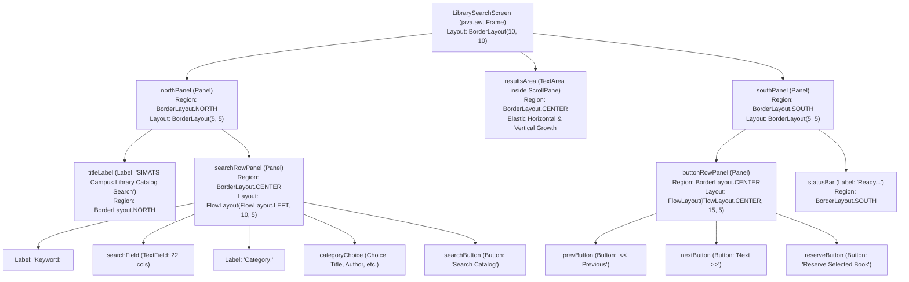

# Task 3: From Sketch to Layout - Campus Library Search Screen

**Course**: Programming in Java (CO4 - Event-Driven GUI Design)  
**Student Name**: Thejas Balaji  
**Register Number**: 192565092  
**Marks**: 9 Marks | **Bloom's Level**: K5 (Evaluate)  

---

## 3.1 Layout Manager Selection & Justification

To build a professional, responsive campus library OPAC search interface, the screen utilizes a nested composition of standard AWT/Swing layout managers:

| Container Component | Layout Manager Selected | Resizing Behavior & Technical Justification |
|---------------------|-------------------------|---------------------------------------------|
| **Top-Level Window (`Frame`)** | `java.awt.BorderLayout(10, 10)` | **Orchestrates Macro Regions**. `BorderLayout` assigns the header/search tools to `NORTH`, the variable search results area to `CENTER`, and navigation/status to `SOUTH`. When the window is resized, `NORTH` and `SOUTH` stretch horizontally but strictly retain their natural preferred heights; `CENTER` expands to consume $100\%$ of all remaining horizontal and vertical screen real estate. |
| **Top Search Panel (`northPanel`)** | `BorderLayout` with inner `FlowLayout(FlowLayout.LEFT, 10, 5)` | **Compact Header with Natural Alignment**. The header title resides in `BorderLayout.NORTH`. The input row (`keywordField`, `categoryChoice`, `searchButton`) resides in `BorderLayout.CENTER` governed by `FlowLayout(LEFT)`. `FlowLayout` preserves the intrinsic preferred dimensions of input controls and wraps them gracefully if the window is narrowed, preventing text clipping. |
| **Center Results View (`resultsArea`)** | Managed directly in `BorderLayout.CENTER` inside `ScrollPane` | **Elastic Expansion**. In `BorderLayout`, the center component is automatically stretched in both dimensions ($W_{\text{center}} = W_{\text{frame}} - 2 \times \text{gap}$, $H_{\text{center}} = H_{\text{frame}} - H_{\text{north}} - H_{\text{south}} - 2 \times \text{gap}$). As the user expands the window to inspect voluminous search records, the catalog list gains maximum viewport area. |
| **Bottom Action Panel (`southPanel`)** | `BorderLayout` with inner `FlowLayout(FlowLayout.CENTER, 15, 5)` | **Centered Action Buttons with Sticky Status Bar**. The navigation buttons ("Previous", "Next", "Reserve Selected Book") are arranged in `FlowLayout(CENTER)` to remain attractively centered along the horizontal axis. The status bar is anchored at `BorderLayout.SOUTH` across the entire bottom edge. |

---

## 3.2 Nested Container Structure (Containment Hierarchy)



---

## 3.3 Implementation Details

The complete implementation is provided in [`LibrarySearchScreen.java`](src/LibrarySearchScreen.java). Key highlights:
- **Responsive Architecture**: Implements nested panels separating form entry, tabular text output, and page navigation.
- **Search Execution & Status Updates**: Keyword matching simulates catalog queries and formats tabular output with column headers (Accession, Title, Author, Status).
- **Enter-Key Binding**: `searchField.addActionListener()` enables users to trigger searches by pressing Enter without clicking the mouse.

---

## 3.4 Resizing Evaluation

| Resizing Condition | Visual & Functional Behavior Observed | Underlying Layout Mechanism |
|--------------------|---------------------------------------|-----------------------------|
| **(a) Window Made Much Wider** (e.g. 550px $\rightarrow$ 1100px) | • Top search row expands horizontally; controls remain left-aligned without stretching unnaturally.<br>• Center catalog text area stretches across the full width, preventing line wrapping on wide bibliographic records.<br>• Bottom navigation buttons remain symmetrically centered along the wider baseline.<br>• Status bar spans the full lower boundary. | In `BorderLayout`, `NORTH` and `SOUTH` stretch to full container width while `FlowLayout` centers or left-aligns buttons within their available horizontal span. `CENTER` expands horizontally to fill all remaining width. |
| **(b) Window Made Much Taller** (e.g. 300px $\rightarrow$ 700px) | • North search bar and South navigation panel maintain their fixed vertical height of 15–35 pixels.<br>• Center results display area grows dramatically (from 250px to 650px height), displaying dozens of book records without requiring scrollbar paging. | `BorderLayout` respects the preferred heights of `NORTH` and `SOUTH` components and directs $100\%$ of vertical delta ($+\Delta H$) to the `CENTER` component. |
| **(c) Window Reduced Smaller Than Minimum Size** (e.g. $< 400\text{px} \times 200\text{px}$) | • In an AWT frame without scrollbars, components in `FlowLayout` may wrap to a second row or become partially obscured.<br>• Center text area shrinks to a small slit where only 1 or 2 lines are visible.<br>• Bottom action buttons may be pushed outside the viewport boundary. | Layout managers attempt to fit components within available bounds. To prevent clipping in production, `frame.setMinimumSize(new Dimension(500, 320))` or wrapping panels in `ScrollPane` enforces a safe lower threshold. |

---

## 3.5 Alternative Concept: Nested Standard Layouts vs `GridBagLayout` vs Absolute Positioning

### Comparison Matrix

| Architectural Approach | Implementation Complexity | Resizing Flexibility & Responsiveness | Maintenance & Refactoring Cost | Cross-Platform Portability |
|------------------------|---------------------------|---------------------------------------|--------------------------------|----------------------------|
| **Nested Layouts (`BorderLayout` + `FlowLayout`)** *(Chosen Solution)* | **Low**: High developer readability; self-documenting hierarchical nesting; straightforward debugging. | **High**: Natural macro-separation; Center expands automatically while headers remain fixed. | **Very Low**: Modifying the search bar row does not alter the center results area or bottom buttons. | **$100\%$ High**: Automatically adapts across Windows, macOS, and Linux font metrics. |
| **Single `GridBagLayout`** | **Very High**: Requires configuring intricate `GridBagConstraints` (`gridx`, `gridy`, `gridwidth`, `weightx`, `weighty`, `fill`, `insets`) for every single widget. | **Very High**: Complete pixel-precise control over stretch ratios, anchoring, and cell spanning. | **High**: Adding or deleting a single row requires re-indexing coordinate constraints across all adjacent cells. | **High**: Dynamic sizing handles varying system DPI and fonts properly. |
| **Absolute Positioning (`setLayout(null)` + `setBounds()`)** | **Lowest Initially, Nightmare Later**: Easy to place widgets at exact $(x, y, w, h)$ coordinates initially. | **Zero / Broken**: Completely unresponsive to resizing. When the user expands the window, components remain stuck in the top-left corner; when shrunk, components are clipped. | **Extremely High**: Any resizing requires manually calculating mathematical coordinate offsets in a custom `ComponentListener`. | **Terrible**: Breaks instantly when executed on systems with different OS font scales, display scaling (125%, 150%), or look-and-feels. |

### Architectural Conclusion
Using **nested layouts (`BorderLayout` + `FlowLayout`)** represents the software engineering sweet spot: it delivers $100\%$ responsive behavior with minimal boilerplate, modular maintainability, and zero risk of cross-platform coordinate distortion.

---

## 3.6 Compilation and Execution

### Compilation Command
```bash
javac -d bin src/*.java
```

### Execution Command
```bash
java -cp bin LibrarySearchScreenDemo
```

### Execution Output
```text
==========================================================
 TASK 3: Campus Library Search Screen - Layout Evaluation 
==========================================================

[STEP 1] Initial Window Setup:
  Top-Level Layout: BorderLayout
  North Panel Layout: BorderLayout
  South Panel Layout: BorderLayout
  Initial Size: 700x420

[STEP 2] Simulating Search Execution:
  Status Bar: Search Completed: 4 records found for "Java" (Title).
  Results Area Character Count: 501

[STEP 3] Responsive Layout Resizing Evaluation:
  Window [ 550x 300] -> North: [ 550x 15] | Center: [ 550x250] | South: [ 550x 15]
  Window [ 750x 450] -> North: [ 750x 15] | Center: [ 750x400] | South: [ 750x 15]
  Window [1100x 700] -> North: [1100x 15] | Center: [1100x650] | South: [1100x 15]

[VERIFICATION] Center region successfully expands to absorb available delta,
               while North and South retain stable preferred heights.
==========================================================
```
