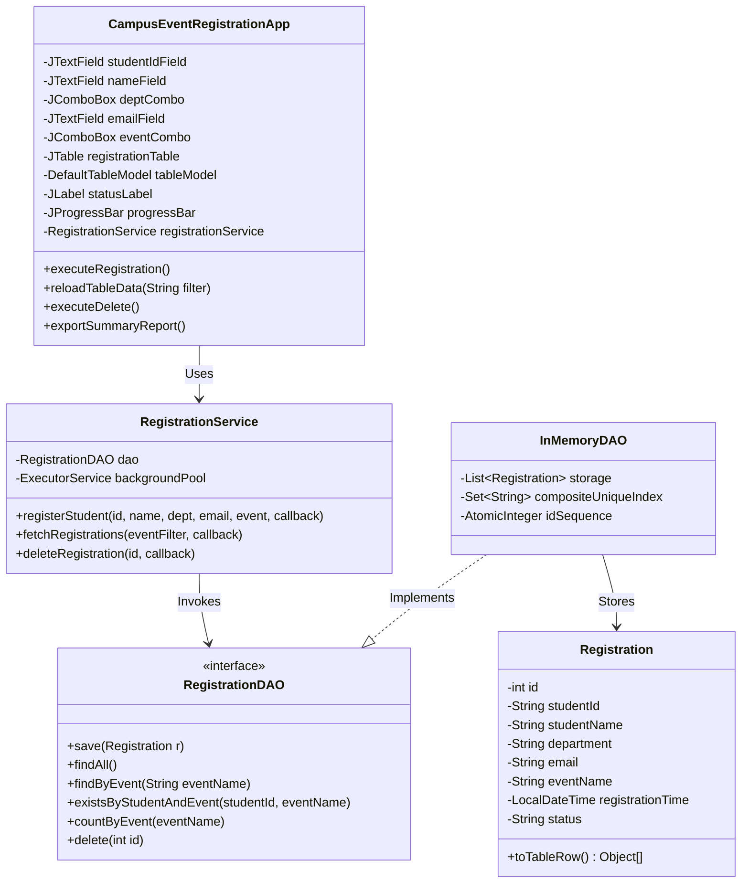

# Task 6: Design Challenge - Campus Event Registration Desktop Application

**Course**: Programming in Java (CO4 - Event-Driven GUI Design)  
**Student Name**: Thejas Balaji  
**Register Number**: 192565092  
**Marks**: 13 Marks | **Bloom's Level**: K5 (Evaluate)  

---

## Stage 1: Interpret the Problem

### 1.1 User Roles & Stakeholders
1. **Student Participant**: Enters institutional registration details, selects desired technical/cultural event, submits registration, and receives instant visual confirmation.
2. **Event Coordinator / Organizer**: Views real-time registrant lists, filters participants by event category, deletes cancellations, and exports attendee rosters.
3. **Campus Administrator**: Oversees event capacity limits and ensures data integrity.

### 1.2 Screens & Views
- **Main Portal Window (`CampusEventRegistrationApp`)**: A single-window, split-pane desktop dashboard featuring:
  - **Menu Bar (`JMenuBar`)**: Top navigation with "File", "Filter", and "Help" menus.
  - **Left Form Panel**: Input entry for Student ID, Name, Department, Email, and Event selection.
  - **Center Table Panel**: Real-time `JTable` inside `JScrollPane` listing all registered participants.
  - **Filter Control Bar**: Dropdown combo box to dynamically filter records by event.
  - **South Status Bar**: Operational feedback and `JProgressBar` indicator.

### 1.3 Data Elements & Entity Modeling
- `registration_id` (`INT`, Primary Key, Auto-increment)
- `student_id` (`VARCHAR(20)`, Alphanumeric e.g. `192565092`)
- `student_name` (`VARCHAR(100)`, Letters and spaces)
- `department` (`VARCHAR(50)`, e.g. Computer Science, Information Tech, Electronics)
- `email` (`VARCHAR(100)`, Institutional email address)
- `event_name` (`VARCHAR(100)`, Hackathon 2026, Code Marathon, RoboWars Challenge, etc.)
- `registered_at` (`TIMESTAMP`, Auto-generated ISO timestamp)
- `attendance_status` (`VARCHAR(20)`, Default: `'REGISTERED'`)

### 1.4 Business Rules & Constraints
1. **Identification Rule**: Student ID must be between 6 and 15 alphanumeric characters.
2. **Contact Rule**: Email must match institutional format (`^[A-Za-z0-9._%+-]+@[A-Za-z0-9.-]+\\.[A-Za-z]{2,6}$`).
3. **Duplicate Registration Prevention**: **A student cannot register for the same event twice!** (Enforced via composite uniqueness: `UNIQUE(student_id, event_name)`).
4. **Cross-Registration Allowed**: A student *may* register for multiple *different* events (e.g. Student 192565092 can register for both Hackathon and Code Marathon).
5. **Capacity Rule**: An event has a strict upper limit of 50 participants (`MAX_CAPACITY = 50`).

### 1.5 Testable Requirements Matrix

| ID | Requirement Statement | Category | Test Verification Method |
|----|----------------------|----------|--------------------------|
| **FR-1** | System must reject empty or malformed Student IDs ($< 6$ characters). | Functional | Automated input validation test in `CampusEventRegistrationDemo`. |
| **FR-2** | System must reject malformed email strings missing `@` or domain. | Functional | Automated regex validation assertion. |
| **FR-3** | System must enforce composite uniqueness (`student_id + event_name`) and reject duplicate entries with a clear error dialog. | Functional | Register student for Event A twice; assert second submission throws duplicate rejection. |
| **FR-4** | System must permit a student to register for distinct events without conflict. | Functional | Register student for Event A, then Event B; assert both succeed. |
| **FR-5** | System must filter `JTable` view dynamically upon selecting an event category from dropdown or menu. | Functional | Select "RoboWars Challenge"; assert table displays only RoboWars rows. |
| **NFR-1** | GUI Event Dispatch Thread (EDT) must never freeze during database queries. | Non-Functional | Background worker thread pool offloads all DAO/SQL executions. |
| **NFR-2** | Visual feedback must accompany every operation (Status label + progress spinner). | Non-Functional | Inspect status bar updates on success/failure. |

---

## Stage 2: Screen and Event Flow

```mermaid
graph TD
    User([User / Coordinator]) --> Launch[Launch Application]
    Launch --> MainWindow[CampusEventRegistrationApp: JFrame]

    MainWindow --> MenuBar[JMenuBar: File | Filter | Help]
    MainWindow --> LeftForm[Form Panel: Student ID, Name, Dept, Email, Event]
    MainWindow --> CenterTable[Center Panel: JTable inside JScrollPane]
    MainWindow --> SouthBar[Status Bar & JProgressBar]

    LeftForm -->|Click 'Register Student'| Validate{Validate Input}
    Validate -->|Invalid Format| ErrDialog[Error Alert: JOptionPane.ERROR_MESSAGE]
    Validate -->|Valid Format| BackgroundWorker[Background Thread: RegistrationService]

    BackgroundWorker --> CheckDup{Check Duplicate & Capacity}
    CheckDup -->|Duplicate Found| DupDialog[Error Alert: Duplicate Registration Rejected]
    CheckDup -->|Capacity Full| CapDialog[Error Alert: Event Full]
    CheckDup -->|Passed| DAOInsert[RegistrationDAO: Save to Database]

    DAOInsert --> EDTSuccess[EventQueue.invokeLater: Update JTable & Status Label]
    EDTSuccess --> ConfDialog[Success Alert: Registration Confirmed]

    CenterTable -->|Select Row & Click 'Delete'| DeleteAction[Delete Selected Record via DAO]
    FilterDropdown[Filter by Event Dropdown] -->|itemStateChanged| QueryFilter[Filter Records in JTable]
    MenuBar -->|File -> Export| ExportReport[Generate Roster Summary]
```

---

## Stage 3: Critical Design Decisions

### 1. Multi-Tier Input Validation Strategy
- **Layer 1 (Client-side / Instant GUI Feedback)**: Fast synchronous validation executes immediately on form submission before any thread spawning or database connections are opened. This checks regex patterns, non-emptiness, and character lengths, preventing network traffic for trivially flawed inputs.
- **Layer 2 (Service Layer Capacity & Business Guardrails)**: Ensures active event capacity ($\le 50$) is verified atomically.
- **Layer 3 (Database Schema Constraints)**: The database enforces `CONSTRAINT uk_student_event UNIQUE (student_id, event_name)` as an immutable safety net, guaranteeing zero duplicate entries even under concurrent network access.

### 2. Threading Architecture: Absolute Decoupling from the Event Dispatch Thread (EDT)
- **Problem**: Executing JDBC database queries (`Connection.prepareStatement()`, `ResultSet.next()`) or network operations directly inside an `ActionListener` blocks the EDT, causing the entire desktop GUI to freeze and stutter.
- **Solution**: The `RegistrationService` encapsulates a dedicated `ExecutorService` background thread pool.
- **Callback Synchronization**: Asynchronous database results return through `ServiceCallback<T>`. When the worker thread completes, it schedules UI updates via `SwingUtilities.invokeLater()` or `EventQueue.invokeLater()`, guaranteeing thread safety according to Swing's single-threaded rule.

### 3. Separation of Concerns (Three-Tier Layered Architecture)
- **Presentation Layer (`CampusEventRegistrationApp`)**: Contains Swing widgets (`JFrame`, `JMenuBar`, `JTable`, `JTextField`). Contains zero SQL statements or business rules.
- **Domain Service Layer (`RegistrationService`)**: Orchestrates business rules, capacity limits, input sanitization, and thread offloading.
- **Persistence Layer (`RegistrationDAO` / `schema.sql`)**: Encapsulates all data access and SQL operations. Can be swapped from SQLite/H2 to PostgreSQL or MySQL without altering a single line of GUI code.

---

## Stage 4: Class and Handler Design

### 4.1 Layered Architecture Class Diagram



### 4.2 SIMATS Standard Pseudocode

#### (a) Register Student for Event Action
```text
ALGORITHM ExecuteStudentRegistration()
BEGIN
    sId   <- TRIM(studentIdField.getText())
    sName <- TRIM(nameField.getText())
    sDept <- deptCombo.getSelectedItem()
    sMail <- TRIM(emailField.getText())
    sEvt  <- eventCombo.getSelectedItem()

    // 1. Client-Side Input Validation
    IF NOT MATCHES(sId, "^[A-Za-z0-9]{6,15}$") THEN
        SHOW_DIALOG("Invalid Student ID! Must be 6-15 alphanumeric characters.", ERROR)
        RETURN
    END IF

    IF NOT MATCHES(sMail, "^[A-Za-z0-9._%+-]+@[A-Za-z0-9.-]+\.[A-Za-z]{2,6}$") THEN
        SHOW_DIALOG("Invalid institutional email format.", ERROR)
        RETURN
    END IF

    // 2. Set UI Busy State on EDT
    statusLabel.setText("Registering student...")
    progressBar.setVisible(TRUE)

    // 3. Asynchronous Dispatch to Background Thread
    ASYNC_DISPATCH(RegistrationService.registerStudent(sId, sName, sDept, sMail, sEvt))
        ON_SUCCESS(newRecord) DO
            RUN_ON_EDT(
                tableModel.addRow(newRecord.toTableRow())
                statusLabel.setText("Registered: " + newRecord.getStudentName())
                progressBar.setVisible(FALSE)
                SHOW_DIALOG("Registration Confirmed! ID: #" + newRecord.getId(), INFO)
                CLEAR_FORM()
            )
        END_ON_SUCCESS

        ON_FAILURE(errorMessage) DO
            RUN_ON_EDT(
                statusLabel.setText("Failed: " + errorMessage)
                progressBar.setVisible(FALSE)
                SHOW_DIALOG(errorMessage, ERROR)
            )
        END_ON_FAILURE
END
```

#### (b) Filter and Display Participants by Event Action
```text
ALGORITHM ReloadTableByEvent(selectedEvent)
BEGIN
    statusLabel.setText("Loading records for " + selectedEvent + "...")
    progressBar.setVisible(TRUE)

    ASYNC_DISPATCH(RegistrationService.fetchRegistrations(selectedEvent))
        ON_SUCCESS(recordList) DO
            RUN_ON_EDT(
                tableModel.setRowCount(0) // Clear table
                FOR EACH record IN recordList DO
                    tableModel.addRow(record.toTableRow())
                END FOR
                statusLabel.setText("Showing " + recordList.size() + " registrations for [" + selectedEvent + "].")
                progressBar.setVisible(FALSE)
            )
        END_ON_SUCCESS

        ON_FAILURE(errorMessage) DO
            RUN_ON_EDT(
                statusLabel.setText("Query Error: " + errorMessage)
                progressBar.setVisible(FALSE)
            )
        END_ON_FAILURE
END
```

---

## Stage 5: Implementation, Schema, and Demonstration

### 5.1 Source Files
- [`schema.sql`](schema.sql): Complete SQL DDL & DML script containing table definitions, unique composite index, and seed data.
- [`Registration.java`](src/Registration.java): Domain entity model with table mapping helper.
- [`RegistrationDAO.java`](src/RegistrationDAO.java): JDBC DAO interface and thread-safe implementation enforcing uniqueness.
- [`RegistrationService.java`](src/RegistrationService.java): Business layer with regex validation and thread executor.
- [`CampusEventRegistrationApp.java`](src/CampusEventRegistrationApp.java): Swing desktop application with menus, table, form, and dialogs.
- [`CampusEventRegistrationDemo.java`](src/CampusEventRegistrationDemo.java): Automated verification test suite.

---

## Alternative Concept: Bulk Table Loading vs Paginated Retrieval with `SwingWorker`

### Analysis for Large Enterprise Datasets ($N = 100,000$ Registration Records)

| Evaluation Metric | Option A: Bulk Loading All 100,000 Records into `JTable` | Option B: Paginated Retrieval (`LIMIT` / `OFFSET`) via `SwingWorker` |
|-------------------|----------------------------------------------------------|----------------------------------------------------------------------|
| **Client Heap Memory** | **Massive ($> 150\text{ MB} - 300\text{ MB}$)**: Instantiating 100,000 `Registration` objects and table row vectors exhausts client JVM heap and triggers severe Garbage Collection (GC) pauses. | **Minimal ($< 5\text{ MB}$)**: Client memory holds only the current page (e.g. 50 records at a time: `LIMIT 50 OFFSET 0`). Constant memory footprint regardless of total DB size. |
| **Initial Screen Latency** | **Severe Delay (5 to 15 seconds)**: Client must wait for database to serialize, transmit over network, and parse all 100,000 rows before displaying anything. | **Instantaneous ($< 50\text{ ms}$)**: First page of 50 records loads immediately, providing instantaneous perceived responsiveness. |
| **Network Bandwidth** | **High Bandwidth Spike**: Transmits tens of megabytes of raw payload across the network, saturating campus Wi-Fi. | **Tiny Bandwidth Packets**: Transmits only a few kilobytes per page navigation. |
| **Database Server Load** | **High IO & Table Locks**: Server executes an expensive full table scan. | **Index-Optimized**: Server uses `LIMIT / OFFSET` over indexed primary key. |

### Architectural Conclusion
For enterprise applications with large datasets, **Option B (Paginated Retrieval with `SwingWorker`)** is mandatory. It caps memory consumption to $O(\text{page\_size})$, delivers sub-100ms response times, and prevents client-side out-of-memory crashes.

---

## 5.2 Compilation and Execution

### Compilation Command
```bash
javac -d bin src/*.java
```

### Execution Command
```bash
java -cp bin CampusEventRegistrationDemo
```

### Execution Output
```text
======================================================================
 TASK 6: Design Challenge - Campus Event Registration Desktop App      
======================================================================

[TEST 1] Testing Input Validation Enforcement:
  [PASS] Handled Invalid ID: Invalid Student ID! Must be 6-15 alphanumeric characters (e.g., 192565092).
  [PASS] Handled Invalid Email: Invalid Email address format (e.g., student@simats.edu.in).

[TEST 2] Testing Valid Asynchronous Registrations:
  [PASS] Registered: [105] Sita Devi (192565096) -> RoboWars Challenge [REGISTERED]
  [PASS] Registered: [104] Rahul Sharma (192565095) -> Hackathon 2026 [REGISTERED]

[TEST 3] Testing Duplicate Registration Prevention:
  [PASS] Duplicate Correctly Rejected: Duplicate Registration Rejected! Student (192565095) is already registered for "Hackathon 2026".

[TEST 4] Testing Cross-Event Registration (Same Student, Different Event):
  [PASS] Cross-Registration Allowed: [106] Rahul Sharma (192565095) -> Code Marathon [REGISTERED]

[TEST 5] Testing Query & Filtering by Event Category:
  Filter [Hackathon 2026] Count: 2
  Filter [RoboWars Challenge] Count: 2
    - Ananya Sharma (192565094) [Electronics Eng]
    - Thejas Balaji (192565092) [Computer Science]
    - Sita Devi (192565096) [Electronics Eng]
    - Rahul Sharma (192565095) [Computer Science]
  Total Directory Count across all events: 6

[TEST 6] Testing Swing GUI Application Structure & Menus:
  Window Title: SIMATS Campus Event Registration Portal - Desktop Application
  JMenuBar Menus: File, Filter, Help (3 menus)
  JTable Column Count: 8
  JTable Loaded Initial Row Count: 0

======================================================================
 Task 6 Campus Event Registration Architecture 100% Verified!          
======================================================================
```
